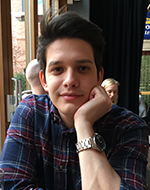

+++
date = "2018-06-10T10:00:33+05:30"
title = "Code and Crayons"
layout = "profile"
+++

The guy behind **Code and Crayons** is me - Christopher. I am a Mobile Software Engineer based in Skövde, Sweden. I am an avid gamer and technology enthusiast, which has greatly influenced my choice of career.

From August 2009 to June 2014 I studied Games & Software Engineering at Blekinge Institute of Technology in Karlskrona, Sweden. The programme focused on C++ and game development, but I did not finish the degree.

I have worked professionally in mobile development since 2014. New Minds employed me and placed me at HiQ from September 2014 to October 2015, after which I became a direct HiQ employee. My first period at HiQ ran from September 2014 to June 2017, including that placement, and involved native iOS apps for clients of different sizes.

From August 2017 to August 2023 I worked at [Sleep Cycle AB][2] as an iOS & Android Native Developer. I started with Life Cycle and App Experience, then moved into Growth work on Android, including analytics, remote configuration and business-to-business features.

Alongside my employment, I co-founded CYBM and worked on OneWin, a social platform for exercise and fitness challenges, from February 2017 to March 2018. It was an after-work project.

I founded Christopher Vikner AB in May 2023, with my freelance role starting in August 2023. I am self-employed through the company and have worked as a Senior iOS Developer on contract at HiQ since September 2023. My current focus is navigation and connected electric vehicles: first an EV navigation app with SwiftUI, KMM and CarPlay, and now a connected-vehicle companion app through HiQ and WirelessCar. In the current project I also built a Godot-based 3D vehicle experience and its integration with iOS.

	

	<h2>Christopher Vikner</h2>

[2]: https://www.sleepcycle.com/
